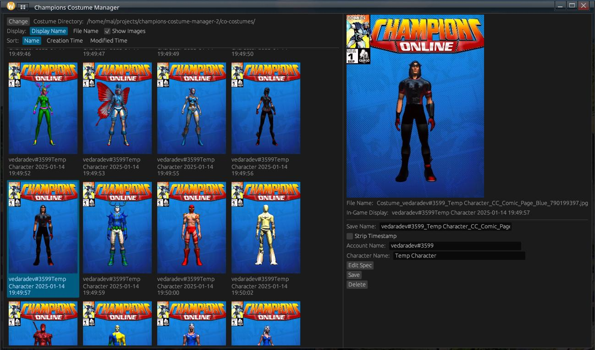
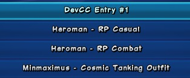
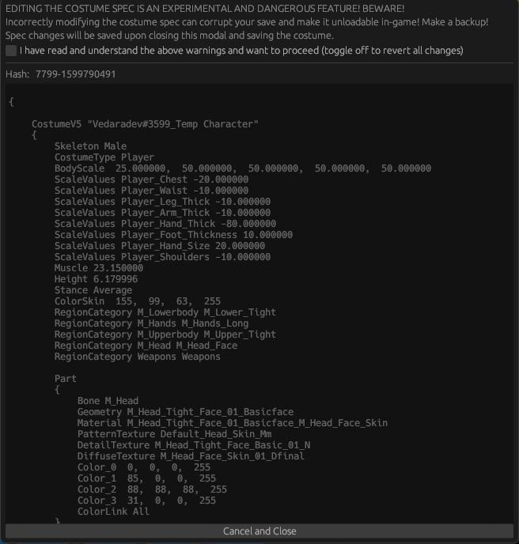

<sub>Note: project/repo name is just a working title and may change in the future.</sub>

# Champions Costume Manager 2

An offline tool for managing in-game displays of costume save files in
Champions Online.



This tool is still early in development, so use at your own risk! If you're
paranoid and want to protect your saves, back them up! Save files can be found
at the following location:

```
<base game installation>/Champions Online/Live/screenshots
```

## Table of Contents
- [Why?](#why?)
- [Setup](#setup)
    - [Requirements](#requirements)
    - [Installation](#installation)
- [Usage](#usage)
    - [Features](#features)

## Why?
Champions Online has an amazing character ("costume" in Champions parlance)
creator but little to no support for managing and organizing the hundreds of
saved costume files that any avid costumer will inevitably generate. To make
matters worse, the default in-game display of costume saves takes the form of
the unruly and often unhelpful `accountnameCharactername Date Time`. Costume
saves are comprised of costume-specific metadata embedded in JPEG image files,
and since the display names of save files in-game are derived from a combination
of this metadata the filename itself, deviating from the default format is a
difficult task for anyone without knowledge of the JPEG format and either a hex
editor or a programming language and image parsing library.

In short, as a starting point, this tool aims to provide a trivial way for users
to change the in-game displays of their saved costumes from this


to something much nicer and more maintainable:



## Setup
Currently the only way to run this tool is to compile the source yourself and
(optionally) add the resulting binary to your path. In the future, GitHub
releases will be utilized to distribute pre-compiled binaries.

### Requirements
- [Rust (1.84.0+) and Cargo](https://www.rust-lang.org/tools/install)

### Installation
1. Clone this repository.
2. Run `cargo b` (for development/debugging) or `cargo b --release`.
3. Run `cargo r` or execute the `ccm` executable directly.

## Usage
Upon launching the program for the first time, if your costume save directory
is not detected you will have to set it manually by clicking the "Change"
button near where the current costume directory is reported in the top left.

From there, usage is fairly simple: click on save files and manage them in the
rightmost panel. At the moment there are no confirmation dialogs for
saving/deleting files so be careful!

The rightmost panel displays the following information:
- File Name: The name of the file as it appears on disk.
- In-Game Display: The name of the save as it will appear in-game.
- Save Name: An editable field which is just the file name excluding the timestamp.
- Account Name: An editable field containing the account name as encoded within the save file.
- Character Name: An editable field containing the character name as encoded within the save file.

##### A Note Regarding Costume Save Display Names

Display names of costumes are constructed of the following:
- The account name as encoded within the costume's JPG save file (specifically
  the first IPTC caption dataset in the APP13 segment).
- The character name as encoded within the costume's JPG save file (specifically
  the second IPTC caption dataset in the APP13 segment).
- The J2000 timestamp at the end of the filename.

Hence, editing the in-game display name involves editing those particular
fields in the GUI.

### Features
- Autodetection of new/deleted costume saves, so you can keep the application
  open while working on costumes.
- Sort files by name, creation time, or modification time.
- Delete costume saves from within the GUI application. Careful! There is
  currently no confirmation dialog for this.
- Ctrl+Click or Shift+Click to select multiple saves, currently just for
  mass-deletion.
- Costume specification editing (EXPERIMENTAL AND DANGEROUS). Note that this
  will NOT allow you to use costumes you have NOT unlocked in-game. The game
  has checks for it. I just included it because why not? Maybe someone will
  find a use for it. For reference, a screenshot of what the costume
  specification actually looks like is included below.

The costume specification editor:

